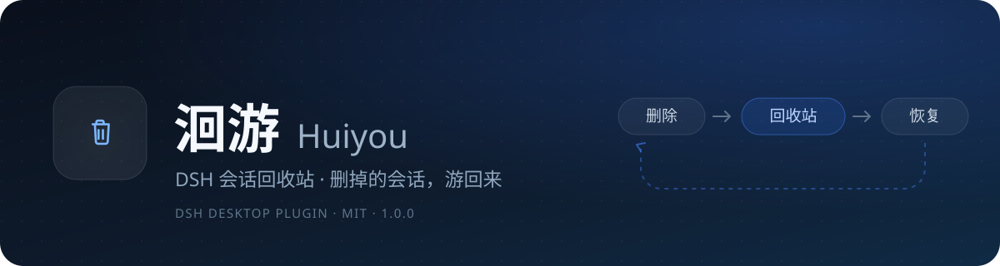
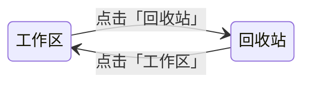
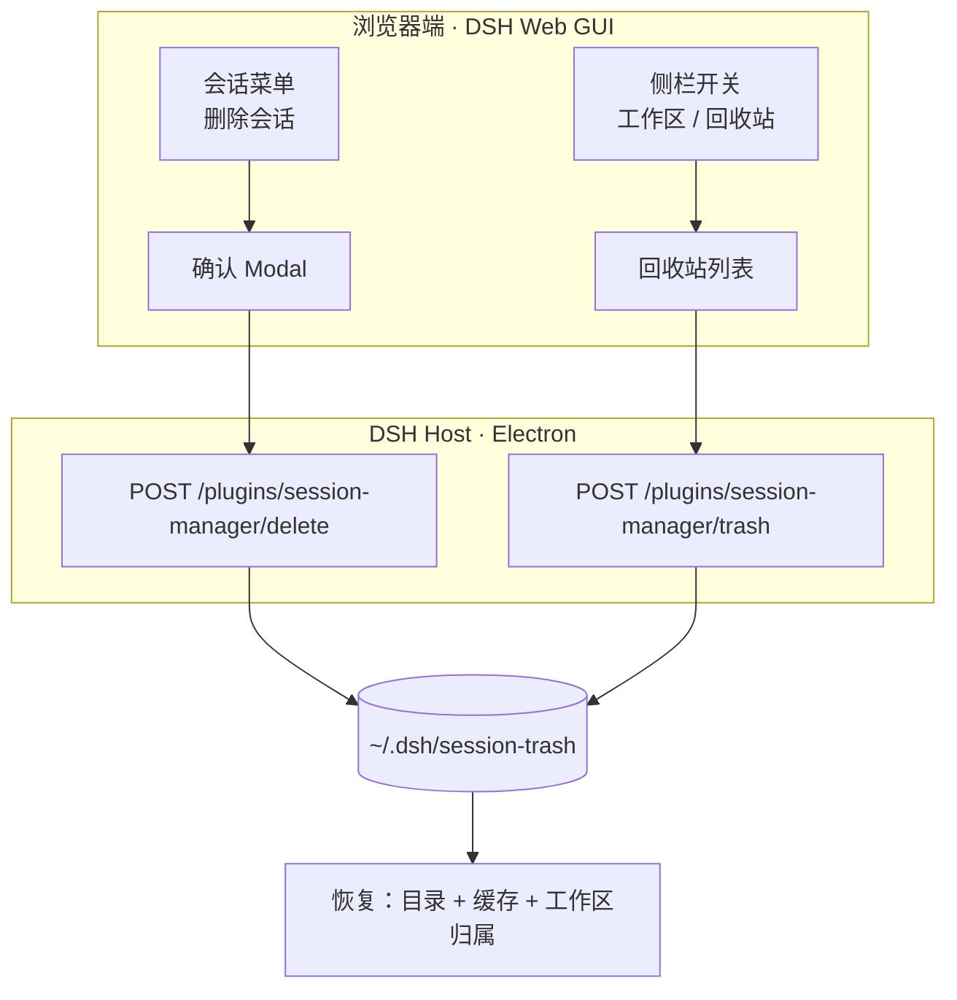

<div align="center">



<p>
  <a href="LICENSE"></a>
  
  
</p>

**删掉的会话，游回来。**

洄游给 [DSH Desktop](https://github.com/deepseek-ai) 的侧栏补上一个真正的**会话回收站**。
删除不再等于隐藏，恢复也不用重启。

</div>

---

## 为什么要有洄游

DSH 自带的「归档会话」只是把会话从列表里藏起来，没有「删除」，更没有「回收站」。
误删、想找回旧对话、清理列表，都缺一个中间态。

洄游把这件事补完整：

> **删除 → 进回收站 → 可搜索 → 可恢复 → 可彻底删除**

删掉的会话不会立刻消失，而是先游进回收站；想找回时，点一下恢复，它又游回原来的工作区。

## 功能

| | 功能 | 说明 |
| --- | --- | --- |
| 🗑️ | **删除会话** | 会话 `⋯` 菜单里的红色「删除会话」，二次确认 |
| ♻️ | **侧栏回收站** | 「工作区 / 回收站」一键换面，回收站有独立标题、搜索和清空 |
| 🔎 | **搜索** | 按标题过滤，输入即筛 |
| ⏳ | **时间** | 每行显示「今天 / N 天」 |
| ↩️ | **恢复** | 会话回到原工作区，标题、位置、会话目录一起回来 |
| 💥 | **彻底删除** | 单条彻底删除，或一键清空（二次确认） |
| ⌨️ | **斜杠命令** | `/sessions` 列出会话，`/delete-session <id>` 删除 |
| 🎨 | **原生观感** | 复用 DSH 的 HoverCard、Modal、Button、Input、图标与设计 token |

## 界面

整个侧栏在「工作区」和「回收站」之间切换：



回收站里每一行是「标题 + 今天/N 天」，鼠标移上去换成 **恢复** 和 **彻底删除** 两个图标；标题右侧是搜索和清空。

## 安装

### 方式一：Release（推荐）

1. 到 [Releases](../../releases/latest) 下载 `huiyou-1.0.0.tgz`。
2. 把它放到一个固定位置，例如 `~/.dsh/plugins/huiyou-1.0.0.tgz`。
3. 编辑 DSH profile（默认 `~/.dsh/profiles/desktop`）的 `package.json`：

   ```jsonc
   {
     "dsh": {
       "profile": {
         "bundles": [
           "@local/dsh-session-manager"
         ]
       }
     },
     "dependencies": {
       "@local/dsh-session-manager": "file:C:/Users/<you>/.dsh/plugins/huiyou-1.0.0.tgz"
     }
   }
   ```

4. 在 profile 目录安装依赖：

   ```bash
   cd ~/.dsh/profiles/desktop
   pnpm install
   ```

5. 重启 DSH。

> `desktop` profile 由 Electron 应用管理，官方 `dsh` CLI 会拒绝直接修改它；手动改 `package.json` + `pnpm install` 即可。

### 方式二：源码

```bash
git clone https://github.com/qiesh-cn/dsh-huiyou.git
cd dsh-huiyou
```

把 `dependencies` 里的路径换成克隆目录（`file:C:/path/to/dsh-huiyou`），其余步骤同上。

## 使用

- **删除**：侧栏会话行悬停 → `⋯` → **删除会话** → 确认。
- **恢复**：侧栏「回收站」→ 悬停某一行 → **恢复**。
- **彻底删除**：回收站行悬停 → 垃圾桶图标；或标题右侧的清空按钮。
- **搜索**：回收站标题右侧的搜索图标。
- **当前会话不能删**：先切到别的会话，或新建一个会话。

## 数据与安全

删除是**移动**，不是抹除：

```text
~/.dsh/session-trash/<ISO 时间>-<session-id>/
├── <session-id>/       # 会话目录
├── <session-id>.json   # 投影缓存
└── meta.json           # 原工作区、标题、删除时间
```

- 恢复时会把目录和缓存放回原工作区；原工作区不存在时，会话会留在「未分组」，仍可正常打开。
- 不联网、不收集数据，所有操作都发生在本地 `~/.dsh`。
- 彻底删除和清空都有二次确认。

## 工作原理



- **Host 侧**（`index.js`）：Cordis 插件注册两个 HTTP 路由，负责移动文件、写 `meta.json`、列出回收站。
- **Client 侧**（`client.js`）：在 `sidebar.workspaces.session.menu.item` 注入删除项，并包装 `sidebar.workspaces` 槽，实现「工作区 / 回收站」切换。
- **恢复**：Host 重新索引会话头并挂回工作区，Client 刷新目录和投影，并把会话并回对应工作区，所以不需要重启。

## 兼容性

- 在 **DSH Desktop 0.2.1-rc.3**（Windows）上开发与验证。
- 侧栏切换依赖 DSH 非公开的 `sidebar.workspaces` 槽。DSH 大版本升级后如果内部结构变化，插件会保持侧栏原样，不会破坏数据，但需要重新适配。
- 仅支持 DSH Desktop 的 Web GUI。

## 开发

无运行时依赖，测试是纯 Node 脚本：

```bash
node test/delete.test.mjs
node test/route.test.mjs
node test/trash.test.mjs
node test/client.test.mjs
```

```text
.
├── index.js            # Host 插件：路由、文件移动、回收站
├── client.js           # 浏览器插件：菜单、Modal、侧栏切换
├── cordis.patch.yml    # 把插件插入 DSH profile
├── locale/             # 中英文案
├── assets/banner.svg
├── icon.svg
└── test/               # 纯 Node 测试
```

> 修改源码后，profile 里的 `file:` 依赖是一份复制，需要重新 `pnpm add` 才会同步。

## 开发者

| 开发者 | 角色 |
| --- | --- |
| **[qiesh](https://github.com/qiesh-cn)** | 作者 · 产品、交互与实现 |
| **大肥鱼**（DeepSeek Harness Agent） | 联合开发 · 代码、测试与文档 |

> 本项目由 qiesh 与 DeepSeek Harness Agent 共同完成。

## License

[MIT](LICENSE) © 2026 qiesh
